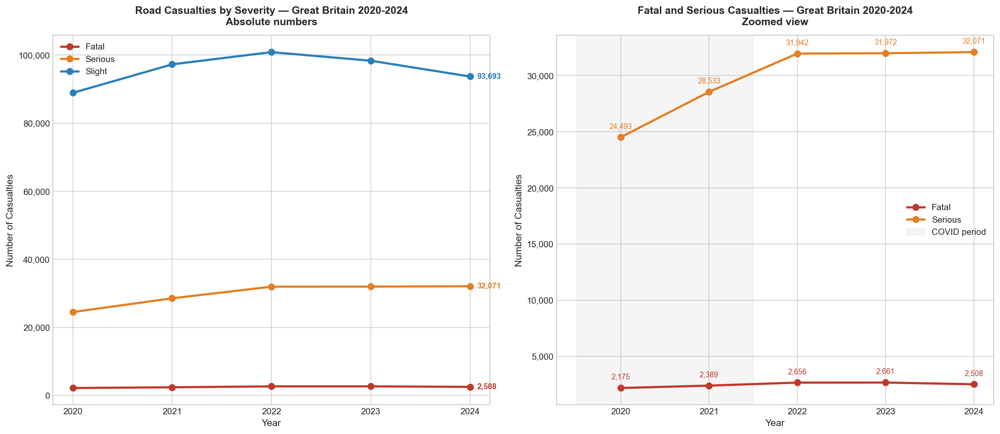
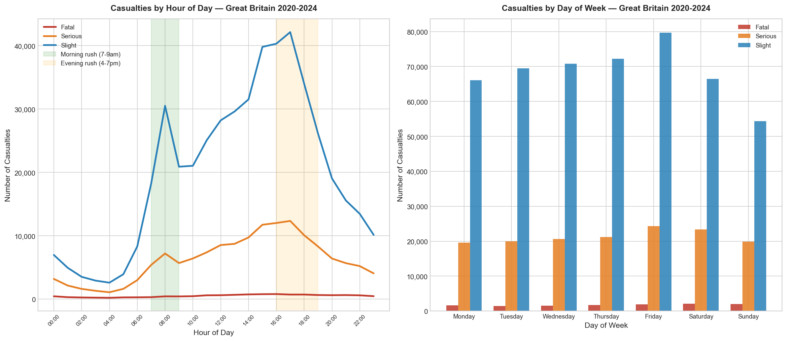
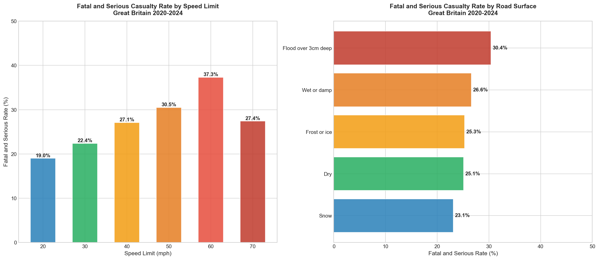
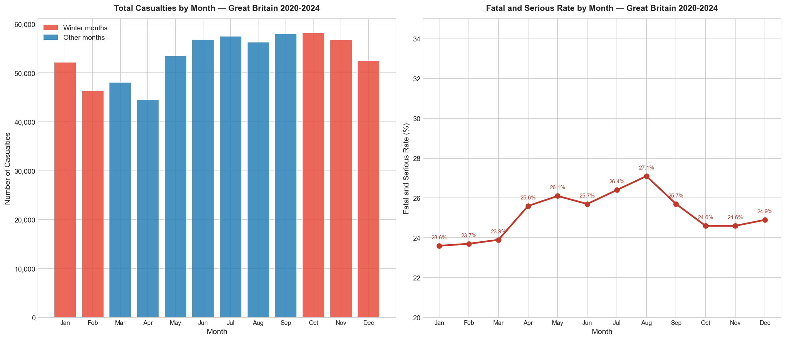
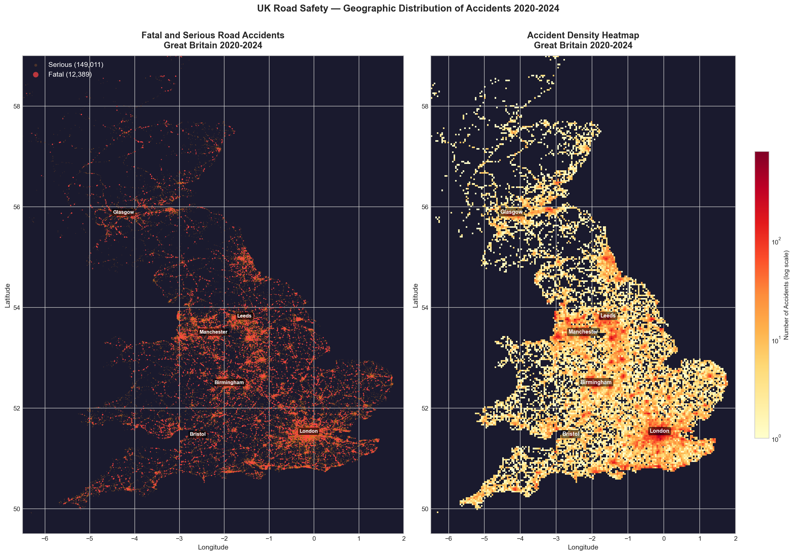
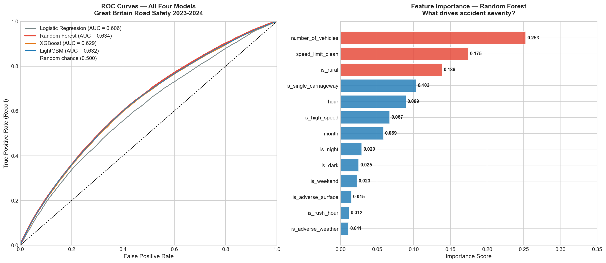

# UK Road Safety Analytics

Five years of Department for Transport STATS19 data on 640,449 road casualties in Great Britain, 2020 to 2024. The project looks at when and where the worst collisions happen and tests whether a model can predict which ones will be serious.

The full write up is in [docs/project-report.md](docs/project-report.md).

## A note on severity

Every severity figure here uses the collision's severity, attached to each casualty in it. A casualty counted as "in a fatal collision" may not have been seriously hurt themselves. The number of casualties recorded as killed is 7,954 over the five years, against 12,389 casualties in fatal collisions. The report explains this in full.

## What I found

| Finding | Result |
|---|---|
| Casualties in serious collisions | 24,493 in 2020 and 32,071 in 2024 (+30.9%) |
| Casualties in fatal collisions | 2,175 in 2020 and 2,508 in 2024 (+15.3%) |
| Busiest hour | 5pm, with 55,216 casualties over the five years |
| Busiest day | Friday, with 105,883 casualties |
| Highest share in fatal or serious collisions by speed limit | 60mph roads at 37.3%, against 27.4% on 70mph roads and 22.4% on 30mph roads |
| Highest share by month | August at 27.1%, against 23.6% in January |

Two cautions. The data starts in 2020, the year of the COVID lockdowns, so there is no pre-pandemic comparison and part of the rise is a recovery from an unusual year. And the busiest times are counts, not rates, since the data has no measure of traffic.

## The model

The target is whether a collision was fatal or serious (25.2% of rows) or slight. I trained on 2020 to 2022 and tested on 2023 and 2024, with 13 features.

| Model | ROC AUC | F1 | Recall |
|---|---|---|---|
| Logistic regression | 0.606 | 0.412 | 0.525 |
| Random Forest (selected) | 0.634 | 0.440 | 0.579 |
| XGBoost | 0.629 | 0.436 | 0.573 |
| LightGBM | 0.632 | 0.439 | 0.577 |

The predictive power is modest. A score of 0.5 is chance, and the best model reaches 0.634, with a precision of 0.355. The four models land close together, which suggests the public data, not the algorithm, is the limit. The most important feature is the number of vehicles involved (0.253), followed by the speed limit (0.175) and whether the road is rural (0.139).

## Data quality

I checked every code lookup against the official DfT data guide. That found one error in my own mapping: casualty type 9 had been labelled "minibus occupant" and is car occupant. It affected 344,129 rows and I corrected it.

## Charts








## Interactive map

`outputs/road_accidents_interactive_map.html` is an interactive Folium map. Download it and open it in a browser. It has three layers: a density map of all 161,400 casualties in fatal or serious collisions, pinpoints for the 12,389 in fatal collisions, and clustered markers for a 20,000 point sample of the serious ones. Each point is a casualty, so a collision with several casualties shows more than once.

## Project structure

```
uk-road-safety-analytics/
├── data/
│   ├── raw/          DfT STATS19 CSV files and data guide
│   └── processed/    cleaned dataset, train and test sets
├── notebooks/
│   ├── 01_data_loading.ipynb
│   ├── 02_exploratory_data_analysis.ipynb
│   ├── 03_feature_engineering.ipynb
│   ├── 04_modelling.ipynb
│   └── 05_conclusions.ipynb
├── outputs/
│   ├── charts/       6 charts
│   └── road_accidents_interactive_map.html
├── docs/
│   └── project-report.md
└── README.md
```

## Tools

Python, pandas, NumPy, scikit-learn, XGBoost, LightGBM, matplotlib, seaborn, folium and Jupyter Notebook.

## Data source

Department for Transport, Road Safety Open Data (STATS19), collision, casualty and vehicle files for the last five years. Open Government Licence v3.0.
https://www.gov.uk/government/statistical-data-sets/road-safety-open-data

## How to run

1. Clone the repository.
2. Install the packages: `pip install pandas numpy matplotlib seaborn scikit-learn folium xgboost lightgbm openpyxl`
3. Download the STATS19 last five years files from the DfT and place them in `data/raw/`.
4. Run the notebooks in order, 01 to 05.
5. Open `outputs/road_accidents_interactive_map.html` in a browser for the map.
